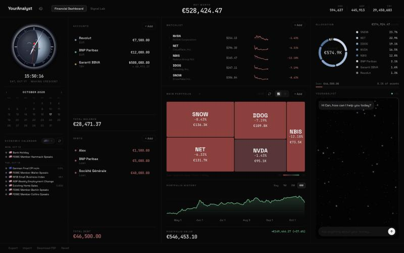
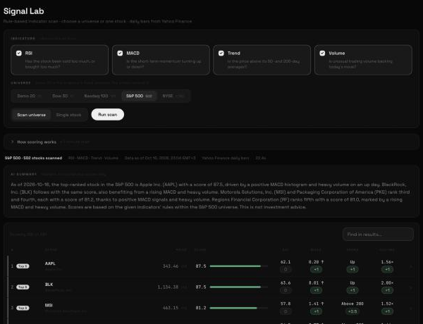
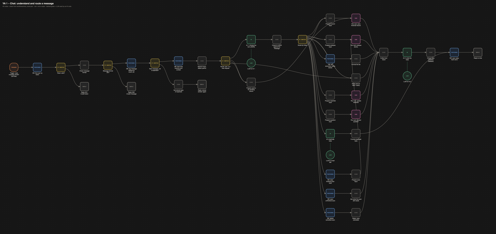

# YourAnalyst

A personal-finance dashboard with an AI assistant you talk to, orchestrated by self-hosted n8n:
record cash, debts and stocks in plain English, see one net worth across currencies, and analyse
US stocks with RSI, MACD, trend and volume. n8n + Postgres + Python analysis API in Docker, a local
LLM (LM Studio), a web dashboard with a chat panel.

Scope and architecture diagram: [`docs/YourAnalyst_Scoping.pdf`](docs/YourAnalyst_Scoping.pdf).



## Quick start: clone to running

Needs Docker Desktop, Python 3, and [LM Studio](https://lmstudio.ai) with `qwen2.5-7b-instruct` loaded and its server on port 1234.

```bash
git clone https://github.com/canoktayy/YourAnalyst.git && cd YourAnalyst
cp .env.example .env            # then set DB_PASSWORD and N8N_ENCRYPTION_KEY to random values
docker compose up -d            # Postgres, analysis API, n8n-init (imports + publishes the workflows), n8n
python3 web/server.py           # dashboard and chat: http://localhost:3500
```

Check that everything is up: `tests/demo_check.sh --chat` (every line must be ✓).

### Environment variables (`.env`)

| Variable | Used by | What |
|---|---|---|
| `DB_USER`, `DB_PASSWORD` | db, n8n-init | Postgres login; n8n-init writes them into the `YA Postgres (local)` credential |
| `N8N_ENCRYPTION_KEY` | n8n, n8n-init | Encrypts the stored credentials. Keep it: a new key makes the saved credentials unreadable |
| `WEBHOOK_URL` | n8n | Public base URL of the webhooks (default `http://localhost:5678/`) |
| `N8N_SECURE_COOKIE` | n8n | `false` by default so the editor also opens in Safari on plain http://localhost; set `true` behind HTTPS |
| `N8N_EDITOR_BASE_URL` | n8n | Base of the execution links the Error Workflow stores (default `http://localhost:5678`) |
| `YA_LLM_MODEL` | workflows | Chat model id, e.g. `qwen2.5-7b-instruct` |
| `YA_LLM_EXTRA_BODY` | workflows | Extra JSON fields for the model request (`{}` for most models) |
| `YA_LLM_URL`, `YA_LLM_API_KEY` | n8n-init | OpenAI-compatible endpoint for the `YA LLM` credential (default LM Studio on the host) |

`.env` is git-ignored; only `.env.example` is committed. No key or token is stored in the repo.

### How to test

- **On demand, without the UI:** `tests/send.sh 01_liability` resends a saved payload from `tests/payloads/` to the chat webhook. `RUN=x tests/send.sh 03_analyse` makes it a new message; the same `RUN` twice shows the duplicate replay.
- **Health check:** `tests/demo_check.sh [--chat]`, exit code = failed checks.
- **Failure path:** `docker compose stop analysis`, then ask "Analyse MSFT with RSI": a readable error reply and an `error_log` row. `docker compose start analysis` afterwards.
- **Unit tests for the AI guards:** `python3 tests/test_checks.py` (needs node).

### Screenshots

| Dashboard with the assistant | Signal Lab |
|---|---|
|  |  |

## The 9 workflows

Numbered in the order a message flows. Every node name says what it does; its prefix says what kind of node it is: `Trigger:`, `DB:` (Postgres), `API:` (HTTP Request), `AI:` / `AI 1` / `AI 2` (LLM Chain), `LLM for …` (chat model), `Run sub:` (Execute Workflow), `Reply …` (Respond to Webhook); If nodes are questions ("Token valid?"); Switch nodes start with `Route`. Pictures are drawn from the JSON by `docs/tools/render_workflows.py` (red = error output).

| Workflow | What it does |
|---|---|
| [YA 1 – Chat: understand and route a message](docs/workflows/chat_router.png) | Chat webhook → guards → AI 1 picks a tool → code checks it → Route by intent → sub-workflow → AI 2 words the reply → numbers checked |
| [YA 2 – Sub: save a financial record](docs/workflows/record_entry.png) | Propose a record, wait for yes / no, save it, return the new net worth |
| [YA 3 – Sub: analyse stocks with indicators](docs/workflows/analyse_stock.png) | One stock or a ranking via the Python API, AI explanation, failure branch |
| [YA 4 – Sub: add or remove watchlist stocks](docs/workflows/watchlist.png) | Find tickers on Yahoo, keep only real ones, save |
| [YA 5 – Sub: answer a question about my money](docs/workflows/answer_question.png) | SQL snapshot → code computes → AI words it → numbers checked |
| [YA 6 – Signal Lab page: scan stocks](docs/workflows/signal_scan.png) | Signal Lab page webhook → YA 3 |
| [YA 7 – Dashboard page: load and save data](docs/workflows/dashboard_api.png) | Dashboard read and form writes |
| [YA 8 – Refresh prices and exchange rates](docs/workflows/valuation_refresh.png) | Every 10 s prices, every 30 min FX, manual run; stale-FX fallback |
| [YA 9 – Error handler: log every failure](docs/workflows/error_handler.png) | Error Workflow of all others: alert with workflow, node and execution URL |



## Layout

| Path | What |
|---|---|
| `db/schema.sql` | Tables, valuation views (`v_position`, `v_line_item`, `v_net_worth`) |
| `db/seed.sql` | Demo user, 20-stock universe, USD FX anchor |
| `docker-compose.yml` | Self-hosted stack: Postgres (`:5433`), analysis API (`:8000`), n8n-init, n8n (`:5678`) |
| `docs/` | Scoping PDF, screenshots, workflow pictures (`docs/workflows/`, drawn by `docs/tools/render_workflows.py`) |
| `workflows/` | n8n workflow JSON built from `workflows/src/*.py`; `workflows/deploy.sh` imports + publishes (mounted at `/workflows`). `YA 9 – Error handler: log every failure` is every workflow's Error Workflow |
| `web/` | Dashboard UI, copied from the author's existing BistRadar "Financial Dashboard" (personal data files excluded). `python3 web/server.py` → http://localhost:3500 |
| `PLAN.md` | Course requirements → nodes, build order, demo script |
| `tests/` | Saved webhook payloads + `send.sh` to resend them on demand |

## How the Docker stack starts

Everything runs in Docker (self-hosted n8n, not n8n Cloud): `db` (Postgres), `analysis` (Python API), `n8n-init` and `n8n` (pinned to 2.43.4). On every `up`, `n8n-init` runs `workflows/bootstrap.sh` before n8n starts: it creates the credentials `YA Postgres (local)` and `YA LLM` from `.env`, imports all 9 `workflows/*.json` and publishes them. So a fresh machine needs no clicks in n8n; the webhooks answer as soon as the stack is up. Only the LLM is outside Docker: LM Studio on the host, reached at `http://host.docker.internal:1234/v1` (override with `YA_LLM_URL` / `YA_LLM_API_KEY` in `.env`).

n8n UI: http://localhost:5678. On first visit, create the owner account (only needed to look at the workflows; they already run without it).

Signal Lab (header tab) is the proposal's analysis screen: pick any of RSI, MACD, MA trend and volume ratio, then scan the fixed 20-stock universe or analyse one ticker. Path: `/ya/scan` → n8n `YA 6 – Signal Lab page: scan stocks` → `YA 3 – Sub: analyse stocks with indicators` → `analysis/api.py`. The ML ranking, Monte Carlo, backtests and P&L tracking of the original BistRadar app were removed (proposal cut line).

n8n Postgres credential (created by `n8n-init`): host `db`, port `5432`, database `youranalyst`, user/password from `.env`.

Reset the database (re-runs schema + seed): `docker compose down -v && docker compose up -d`. **This deletes all data.**

Back to the default demo dashboard (3 accounts, 3 debts, 5 holdings, 5-stock watchlist from `db/seed.sql`) without touching quotes or logs: `./db/reset_demo.sh`.

## Desktop app (Dock)

`desktop/build_app.sh` builds `/Applications/YourAnalyst.app`: a native window (WKWebView) on the dashboard with the blue X mark of the dashboard header as its icon (`desktop/icon_1024.png`, cut from `../your analyst dashboard içi logo.png` by `desktop/make_icon.js … 1024 markicon`). On launch it starts whatever is not running: Docker (`docker compose up -d`), the LM Studio server (`lms server start`) and `web/server.py` (log: `/tmp/youranalyst-web.log`). Closing the window quits the app; while it is open, a watchdog restarts `web/server.py` within ~15 s if it stops, and reloads the page. The header mark `web/brand-mark.png` is cut from `../your analyst dashboard içi logo.png` with `osascript -l JavaScript desktop/make_icon.js <logo> web/brand-mark.png 128 mark` (the wordmark next to it is real text, Montserrat). It is written in JXA (`desktop/app.js`) because this Mac's Command Line Tools cannot compile Swift/Objective-C; JXA cannot answer WebKit's completion handlers, so `confirm()` returns false in the app (old Import / Reset / delete-portfolio buttons). Use the browser for those. Export and Download PDF save to ~/Downloads.

## Demo and tests

- `DEMO.md`: the rehearsal sheet (messages to type, what to say, fallbacks, likely questions).
- `tests/demo_check.sh [--chat]`: pre-demo health check; exit code = failed checks.
- `python3 tests/test_checks.py`: unit tests for the AI guards (wording and currency checks; needs node).
- `db/reset_demo.sh`: back to the default demo data.

## Moving to Supabase

1. Create the project, open the SQL Editor, and run `db/schema.sql` then `db/seed.sql`.
2. In n8n, point the Postgres credential at the Supabase connection details (Session pooler, SSL on).

## Key rules

- **Duplicate prevention:** every message inserts into `request_log` with `on conflict (user_id, event_id) do nothing returning id`. Zero rows returned = replay → return the stored `response`.
- **Confirmation:** the AI's interpretation goes to `pending_confirmation`, which allows one open row per user. Only a "yes" writes to `asset`/`holding`/`liability`.
- **Numbers come from SQL/Code, never from the LLM.** FX: `amount * usd_per_unit(from) / usd_per_unit(base)`.
- **Prices:** `price_status` is `ok`, `stale` (more than 3 days old) or `unavailable`.
- **Auth:** the dashboard sends `X-YA-Token`; n8n compares `sha256(token)` with `app_user.api_token_hash`. The demo token is in `db/seed.sql`, so change it before a public demo.
